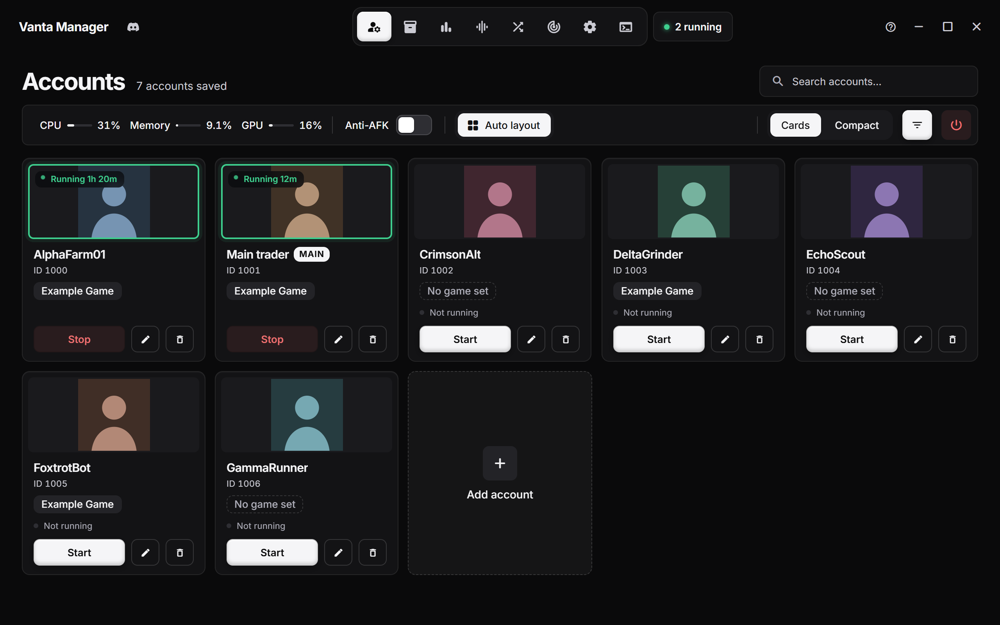
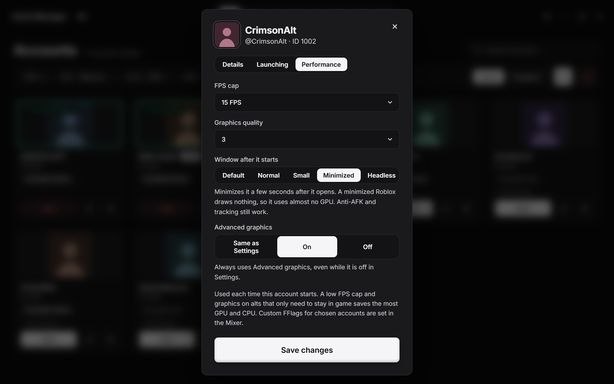
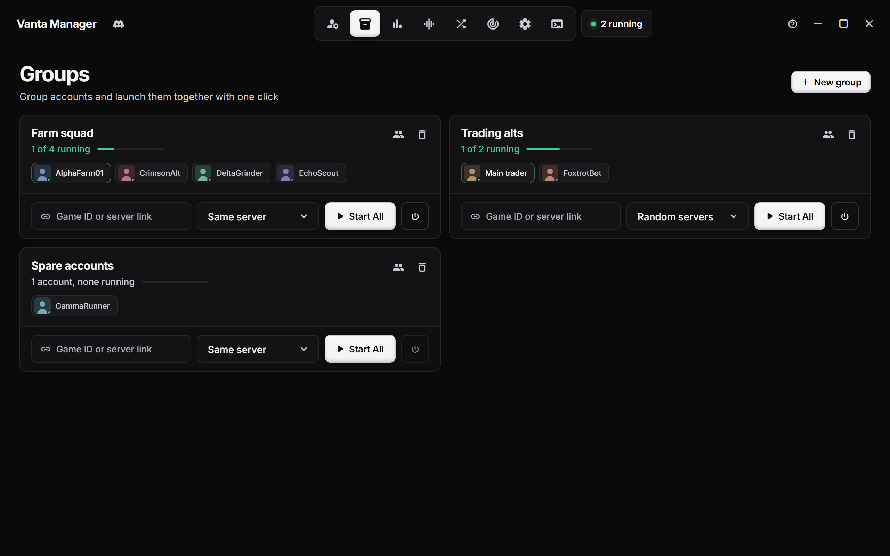
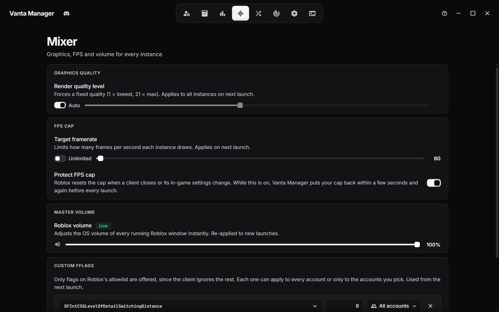
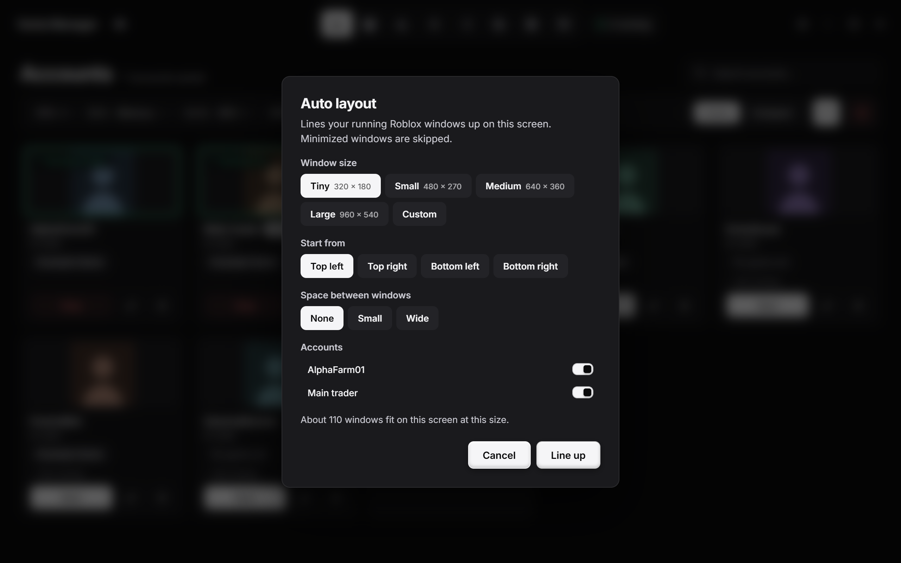
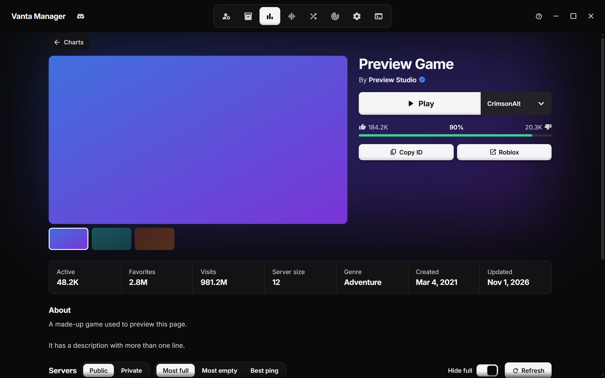
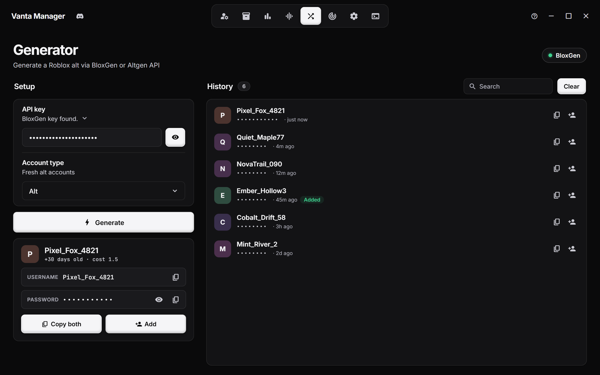

<div align="center">


# Vanta Manager

**Run as many Roblox accounts as you want, side by side, on Windows.**<br>
Launch, line up and tune every client from one dashboard.

*Formerly MultiRoblox. Your saved accounts and settings carry over.*

<br>

[](https://github.com/PookiePepelsss/Vanta-Manager/releases)
[](https://github.com/PookiePepelsss/Vanta-Manager/releases)
[](https://tauri.app/)
[](LICENSE)

<br>



</div>

<br>

## Highlights

- **One exe, no install.** Download it and run it. The native helper is embedded.
- **Every account at once.** Roblox normally allows one client. Vanta Manager opens a fresh one for each account, each signed in as that account.
- **Control each client.** Give every account its own FPS cap, graphics level and window mode.
- **Headless clients.** Run alts with no window and no taskbar button, so they draw nothing.
- **Built for farms.** Groups, auto-relaunch, anti-AFK and tiled windows keep a lot of clients manageable.
- **Private.** Cookies are encrypted on your PC. Nothing is uploaded anywhere.

<br>

## Quick start

1. Download `VantaManager.exe` from [**Releases**](https://github.com/PookiePepelsss/Vanta-Manager/releases). It isn't code-signed, so Windows SmartScreen may ask you to confirm.
2. Run it, click **Add account**, and sign in through the Roblox window or paste a cookie.
3. Press **Start** on as many accounts as you like.

Coming from MultiRoblox? Run the new exe and your accounts and settings are already there.

<details>
<summary><b>Build it yourself</b></summary>

<br>

You need the [Rust toolchain](https://rustup.rs) and Node.js.

```bash
git clone https://github.com/PookiePepelsss/Vanta-Manager.git
cd Vanta-Manager/MultiRoblox
build.bat
```

The finished exe lands in `dist\VantaManager.exe`. Run the tests with `cargo test --manifest-path src-tauri/Cargo.toml --lib`.

</details>

<br>

## Screenshots

<table>
  <tr>
    <td width="50%"><br><sub><b>Per-account performance.</b> FPS cap, graphics, window mode and Advanced graphics for each account.</sub></td>
    <td width="50%"><br><sub><b>Groups.</b> Launch or kill a whole squad at once.</sub></td>
  </tr>
  <tr>
    <td width="50%"><br><sub><b>Mixer.</b> Render quality, FPS cap, volume and custom FFlags.</sub></td>
    <td width="50%"><br><sub><b>Auto layout.</b> Tile every running window on your screen.</sub></td>
  </tr>
  <tr>
    <td width="50%"><br><sub><b>Game pages.</b> Pick an account, press Play, browse servers.</sub></td>
    <td width="50%"><br><sub><b>Generator.</b> Make accounts with a BloxGen or Altgen key.</sub></td>
  </tr>
</table>

> Screenshots use made-up sample accounts and a made-up game.

<br>

## Features

**Accounts and launching**
- Launch as many accounts side by side as you want
- Sign in through a Roblox login window, or paste a cookie
- Set a game ID, invite link or private server link per account so it launches straight there
- Nicknames, a MAIN tag, search, filtering, and a Cards or Compact view
- Right-click a running account to kill it, go headless, trim its memory, set its priority, or copy its IDs
- Relaunch an account into the same game when it disconnects
- Launches the current Roblox build. Works with vanilla Roblox and Bloxstrap-style bootstrappers (Bloxstrap, Fishstrap, Froststrap, Voidstrap and other forks), and you can choose which install to use

**Per-account performance**

In **Edit account**, then **Performance**, each account gets its own:
- FPS cap, from 10 to unlimited
- Graphics quality
- Window mode: *Default*, *Normal*, *Small*, *Minimized* or *Headless*
- Advanced graphics: on, off, or follow Settings

These are applied right before the client starts, and your shared values are put back afterwards, so one account's setup never leaks into another's. Capping alts to 15 to 30 FPS and running them minimized or headless saves the most.

**Headless clients**
- A headless client has no window and no taskbar button, and it draws nothing
- The game itself keeps running as normal: physics, scripts and the connection carry on
- Anti-AFK and Tracking still work. The window is shown for a moment when one of them needs it
- Turn on **Headless clients** in Settings to start every account that way, or set it per account
- Right-click an account to go headless or show its window at any time
- If Vanta Manager closes, every headless window comes back to the taskbar

**Mixer and graphics**
- Render quality, FPS cap and volume for every running instance in one panel
- The FPS cap can be protected, so Roblox can't reset it
- **Advanced graphics**: anti-aliasing (x1 to x8), texture quality and grass on or off, through Roblox's own allowlisted flags
- **Custom FFlags**: add flags from Roblox's allowlist and apply each to every account or only the ones you pick
- Choose the graphics API (Direct3D 11, OpenGL or Vulkan) in Settings

**Auto layout and groups**
- Auto layout tiles your running windows in rows. Pick a size from 320 × 180 up to 960 × 540, or enter your own, choose the starting corner and the gap, and put the windows back with one click
- Accounts you start later line up automatically after the first layout
- Groups bundle accounts so you can launch or kill them together
- A group can join the same server, random servers, the closest servers, or their own private servers

**Games, tracking and generator**
- Charts show top playing now, top rated and top earning games, with search
- Game pages show details, likes and the public and private server lists. Press **Play** with any saved account
- Tracking sends timed screenshots of each account to a Discord webhook
- The generator makes accounts with a [BloxGen](https://bloxgen.net/) or [Altgen](https://altgen.me/) key, keeps a searchable history, and adds one to your accounts in a click

**Everything else**
- Anti-AFK taps a key into every open Roblox window on an interval you choose (5 to 17 minutes), so the idle kick never fires
- RAM limiter per instance, RAM trim (manual or automatic), and lower CPU priority once several accounts run
- A live log viewer with in-page search (Ctrl+F)
- 13 themes, and a search box that finds any setting

**Light on resources**
- Closed clients are noticed the moment Windows reports them, instead of by scanning on a timer
- While the window is minimized or in the tray, background checks slow down
- In the tray, the app also releases the memory it doesn't need

<br>

## How it works

Roblox prevents multiple instances by holding a Windows mutex. Vanta Manager grabs that mutex first through a small native helper (`RobloxNative.exe`, written in C#), so Roblox opens a fresh instance every time. Each account gets its own auth ticket before launch, so every window signs in as a different account.

Login opens a native window and reads the session cookie once you sign in. Going headless uses the same window call the taskbar does, and nothing is read from or written into the Roblox client.

<br>

## FAQ

<details>
<summary><b>Will Roblox ban me for this?</b></summary>

<br>

Running multiple accounts isn't something Roblox actively bans for normal use, but using this software is at your own risk. See the disclaimer below.

</details>

<details>
<summary><b>Does a headless client still play the game?</b></summary>

<br>

Yes. Going headless only removes the window and stops it drawing. The game keeps running, so your character stays in the server and physics and scripts carry on.

</details>

<details>
<summary><b>Where is my data stored?</b></summary>

<br>

On your PC, in `%APPDATA%\multiroblox`. The folder keeps its old name so existing installs find their data. Cookies are encrypted with Windows DPAPI by default, or with AES-256-GCM if you set your own key. Nothing is uploaded anywhere. To update, run the new exe in place of the old one.

</details>

<details>
<summary><b>My antivirus flags RobloxNative.exe</b></summary>

<br>

Running two Roblox clients at once means closing Roblox's single-instance lock, which looks like a cheat tool to heuristic scanners. It's a false positive. The helper is one readable C# file in this repo, but the app isn't code-signed, so nothing vouches for it automatically.

</details>

<details>
<summary><b>Roblox opens and then reinstalls itself</b></summary>

<br>

That happens when a launch picks an out-of-date Roblox install. Vanta Manager launches the current build and tells you when none is up to date. If you use a bootstrapper, open **Settings**, then **Roblox**, and choose that install.

</details>

<br>

## Disclaimer

Using this software is at your own risk. The author is not responsible for any bans, suspensions, or other action taken against your account. Vanta Manager is not affiliated with Roblox Corporation.

<br>

## Support

If Vanta Manager saved you time, consider tossing a tip my way.

| Coin | Address |
|---|---|
| BTC | `15kEbCxtNKbQ2g16AmiW8BeEKU3h6i9S46` |
| ETH | `0x179ab005a9CD84769934aB66825D38C347D9AB4d` |
| LTC | `LTLYLK9mUMVUk9Gk5j3W8oYqtq1cYiU3Uy` |

<br>

## License

Free to use, modify and share for non-commercial use. You may not sell it, and any copy or fork must credit **PookiePepelsss** as the original author. See [LICENSE](LICENSE) for the full text.

<div align="center">
<br>
<sub>Made by PookiePepelsss</sub>
</div>
