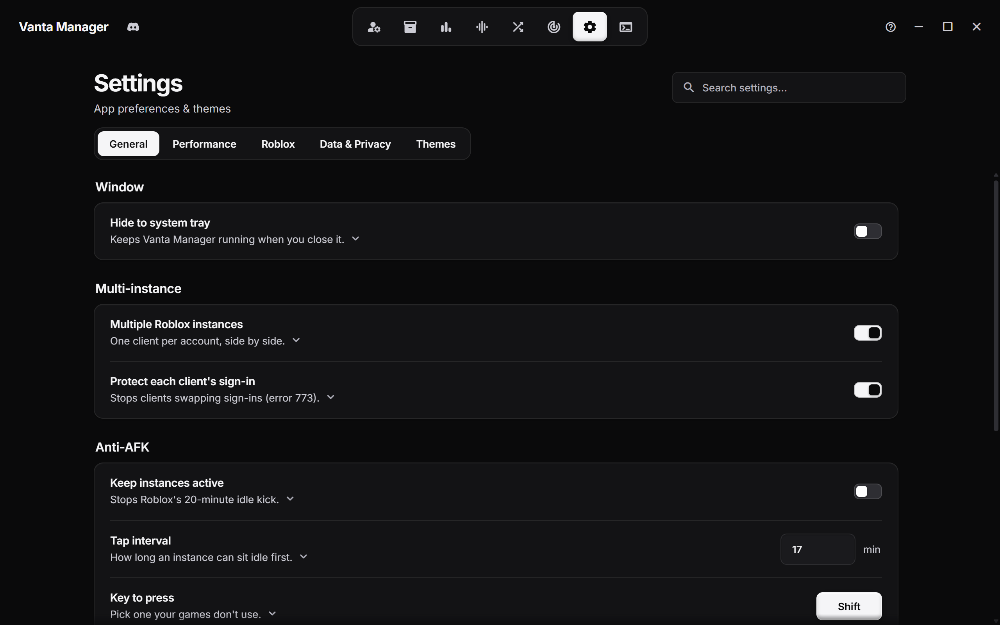
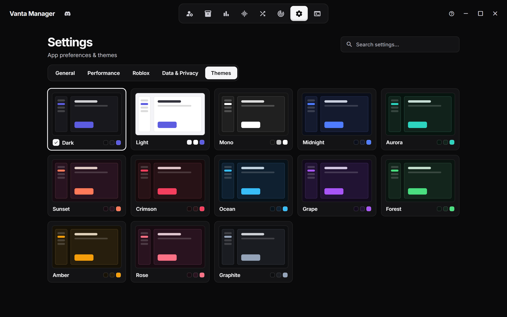

<div align="center">


# Vanta Manager

**Run as many Roblox accounts as you want, side by side, on Windows.**<br>
Launch, line up, monitor and tune every client from one dashboard.

*Formerly MultiRoblox. Your saved accounts and settings carry over.*

<br>

[](https://github.com/PookiePepelsss/Vanta-Manager/releases)
[](https://github.com/PookiePepelsss/Vanta-Manager/releases)
[](https://tauri.app/)
[](LICENSE)

<br>


</div>

<br>

## Why Vanta Manager

|   |   |
|---|---|
| **One exe, no install** | Download it, run it. The native helper is embedded, so there are no extra files to keep next to it. |
| **Every account at once** | Roblox normally allows one client. Vanta Manager opens a fresh instance for each account you start, each signed in as that account. |
| **Tune each client** | Give every account its own FPS cap, graphics level and window mode, so alts that only need to sit in a game cost very little. |
| **Light on your PC** | Minimize, shrink or fully hide windows, cap RAM per client, and let the app itself drop its memory while it sits in the tray. |
| **Built for farms** | Groups, auto-relaunch, anti-AFK and tiled windows keep a lot of clients manageable. |
| **Your data stays yours** | Cookies are encrypted on your PC with Windows DPAPI or your own passphrase. Nothing is uploaded anywhere. |

<br>

## Quick start

1. Download `VantaManager.exe` from [**Releases**](https://github.com/PookiePepelsss/Vanta-Manager/releases).
2. Run it. If Windows SmartScreen warns about an unknown publisher, choose **More info**, then **Run anyway**. The app isn't code-signed.
3. Click **Add account** and sign in through the Roblox window, or paste a cookie.
4. Press **Start** on as many accounts as you like.

**Coming from MultiRoblox?** Run the new exe and everything is already there. Accounts, groups and settings live in the same folder as before.

<details>
<summary><b>Build it yourself</b></summary>

<br>

You need the [Rust toolchain](https://rustup.rs) and Node.js.

```bash
git clone https://github.com/PookiePepelsss/Vanta-Manager.git
cd Vanta-Manager/MultiRoblox
build.bat
```

The finished exe lands in `dist\VantaManager.exe`. To run the tests:

```bash
cargo test --manifest-path src-tauri/Cargo.toml --lib
```

</details>

<br>

## A look around

<table>
  <tr>
    <td width="50%"><br><sub><b>Right-click menu.</b> Kill, hide the window, trim memory, set priority, edit, copy IDs.</sub></td>
    <td width="50%"><br><sub><b>Per-account performance.</b> FPS cap, graphics, window mode and Advanced graphics for each account.</sub></td>
  </tr>
  <tr>
    <td width="50%"><br><sub><b>Groups.</b> Launch or kill a whole squad at once, with a server mode for each.</sub></td>
    <td width="50%"><br><sub><b>Auto layout.</b> Tile every running window on your screen.</sub></td>
  </tr>
  <tr>
    <td width="50%"><br><sub><b>Mixer.</b> Render quality, FPS cap, volume and custom FFlags for every instance.</sub></td>
    <td width="50%"><br><sub><b>Performance.</b> RAM limiter, priority, hidden windows and Advanced graphics.</sub></td>
  </tr>
  <tr>
    <td width="50%"><br><sub><b>Game pages.</b> Pick an account, press Play, browse servers.</sub></td>
    <td width="50%"><br><sub><b>Charts.</b> Top playing, top rated and top earning games.</sub></td>
  </tr>
  <tr>
    <td width="50%"><br><sub><b>Generator.</b> Make accounts with a BloxGen or Altgen key and add them in one click.</sub></td>
    <td width="50%"><br><sub><b>Tracking.</b> Timed screenshots sent to a Discord webhook.</sub></td>
  </tr>
  <tr>
    <td width="50%"><br><sub><b>Compact view.</b> A dense list for large account collections.</sub></td>
    <td width="50%"><br><sub><b>Settings.</b> Short descriptions, details on demand, and search across every tab.</sub></td>
  </tr>
</table>

<div align="center">
<br>
<sub><b>Themes.</b> Light, dark and eleven accent themes.</sub>
</div>

> Screenshots use made-up sample accounts and a made-up game.

<br>

## Features

<details open>
<summary><b>👤 Accounts</b></summary>

<br>

- Launch as many accounts side by side as you want
- Sign in through a real Roblox login window, or paste a cookie directly
- Set a game ID, invite link or private server link per account so it launches straight there
- Nicknames, a MAIN tag, search, filtering, and a Cards or Compact view
- Right-click a running account to kill it, hide or show its window, trim its memory, or set its priority (Realtime down to Low)
- Relaunch an account into the same game when it disconnects
- Live CPU, memory and GPU readout for the whole PC
- Launches the current Roblox build, so a stale install doesn't make Roblox update and reinstall itself
- Works with vanilla Roblox and Bloxstrap-style bootstrappers (Bloxstrap, Fishstrap, Froststrap, Voidstrap and other forks). Installs are found automatically, and you can pick which one launches use

</details>

<details>
<summary><b>⚡ Per-account performance</b></summary>

<br>

Open **Edit account**, then **Performance**:

- **FPS cap**: 10 to unlimited, just for this account
- **Graphics quality**: its own level, just for this account
- **Window after it starts**: *Default*, *Normal*, *Small*, *Minimized* or *Hidden*
- **Advanced graphics**: always on, always off, or follow Settings

These are applied right before the client starts and your shared values are put back afterwards, so one account's setup never leaks into another's.

</details>

<details>
<summary><b>🫥 Hidden windows</b></summary>

<br>

- A hidden client has no window and no taskbar button, and draws nothing, so its GPU use drops to almost zero
- The game itself keeps running as normal: physics, scripts and the connection carry on
- Anti-AFK and Tracking still work. The window is shown for a moment when one of them needs it, then hidden again
- Turn on **Hide Roblox windows** in Settings to start every account hidden, or set it per account
- Right-click an account to show or hide its window at any time
- If Vanta Manager closes, every hidden window comes back to the taskbar

</details>

<details>
<summary><b>🎛️ Mixer and Advanced graphics</b></summary>

<br>

- Render quality, FPS cap and volume for all running instances in one panel
- Graphics quality writes to Roblox's fast flags. The FPS cap writes Roblox's client settings and can be protected, so Roblox can't reset it
- Live, per-instance volume control
- **Advanced graphics**: anti-aliasing (x1 to x8), texture quality and hidden grass, through Roblox's own allowlisted flags
- **Custom FFlags**: add flags from Roblox's allowlist and apply each to every account or only the ones you pick. Anything the client would ignore isn't offered
- Kill all instances with one click

</details>

<details>
<summary><b>🪟 Auto layout</b></summary>

<br>

- Tiles your running Roblox windows in rows on the screen, as small as 320 × 180 or as large as you like
- Choose the starting corner, the gap between windows, and which accounts to include
- Accounts you start later line up automatically after the first layout
- Undo puts every window back where it was

</details>

<details>
<summary><b>📦 Groups</b></summary>

<br>

- Bundle accounts into groups (farm squad, trading alts and so on)
- Launch or kill an entire group at once
- Pick how a group joins: the **same server**, **random** public servers, the **closest** servers, or **their own private servers**

</details>

<details>
<summary><b>🎮 Charts and game pages</b></summary>

<br>

- Browse top playing now, top rated and top earning games, or search any game
- Game pages show details, screenshots, likes and the server list, public and private
- Press **Play** with any saved account, or join a specific server

</details>

<details>
<summary><b>🕹️ Anti-AFK</b></summary>

<br>

- Taps a key into every open Roblox window on an interval you choose (5 to 17 minutes), so the idle kick never fires
- Pick which key is pressed. Shift is the safest, since it moves nothing
- Works on minimized and hidden windows too

</details>

<details>
<summary><b>📸 Tracking</b></summary>

<br>

- Automated per-account screenshots sent to a Discord webhook on a timer
- Outline one or more capture spots per account, or grab the full window

</details>

<details>
<summary><b>🎲 Generator</b></summary>

<br>

- Paste a [BloxGen](https://bloxgen.net/) or [Altgen](https://altgen.me/) key. The service is detected from the key
- The new account appears in its own card with the password hidden until you ask for it
- A searchable history shows when each account was made and marks the ones you've added
- **Add** signs in with the account's password and saves it, falling back to the cookie if needed

</details>

<details>
<summary><b>⚙️ Settings</b></summary>

<br>

- **General**: hide to the tray, multi-instance, sign-in protection between clients (error 773), anti-AFK, relaunch on disconnect, live pictures on running tiles
- **Performance**: RAM limiter (per instance, globally or per account), RAM trim (manual or automatic), lower CPU priority once several accounts run, hide Roblox windows, graphics API (Direct3D 11, OpenGL or Vulkan) and Advanced graphics
- **Roblox**: choose which install launches use
- **Data & Privacy**: your own encryption key or Windows DPAPI, clear all accounts
- **Themes**: light, dark and eleven accent themes
- A search box finds any setting, and each one has a short description with details on demand
- **Logs** has a live viewer with in-page search (Ctrl+F)

</details>

<details>
<summary><b>🍃 Resource use</b></summary>

<br>

- Closed clients are noticed the moment Windows reports them, instead of by scanning on a timer
- While the window is minimized or in the tray, background checks slow down and the app asks Windows to trim its own memory
- Per-client RAM caps, a lowered priority, and minimized or hidden windows keep many clients usable on one machine

</details>

<br>

## Running many accounts

A few settings make the biggest difference when you have lots of clients open:

1. **Cap the FPS** on alts that only need to stay in a game. 15 to 30 FPS is plenty for most of them.
2. **Minimize or hide** those windows. A minimized client draws nothing, so its GPU use falls to almost nothing.
3. **Turn on Advanced graphics** for the lowest textures, no anti-aliasing and no grass. It mainly saves GPU memory.
4. **Set a RAM limit** per instance to push idle memory out to disk.
5. **Lower the priority** once several accounts run, so the rest of your PC stays responsive.

Do this per account in **Edit account**, so your main account keeps full quality.

<br>

## How it works

Roblox prevents multiple instances by holding a Windows mutex. Vanta Manager grabs that mutex first through a small native helper (`RobloxNative.exe`, written in C#), so Roblox opens a fresh instance every time. Each account gets its own auth ticket before launch, so every window signs in as a different account.

Login opens a native, chromeless window with no external browser involved, and reads the session cookie once you sign in. The helper is embedded in the app, so the exe runs on its own.

Hiding a window uses the same call the taskbar does. Nothing is read from or written into the Roblox client.

<br>

## FAQ

<details>
<summary><b>Will Roblox ban me for this?</b></summary>

<br>

Running multiple accounts isn't something Roblox actively bans for normal use, but using this software is at your own risk. See the disclaimer below.

</details>

<details>
<summary><b>Does a hidden client still play the game?</b></summary>

<br>

Yes. Hiding only removes the window and stops it drawing. The game keeps running, so your character stays in the server and physics and scripts carry on.

</details>

<details>
<summary><b>Where is my data stored?</b></summary>

<br>

Locally on your PC, in `%APPDATA%\multiroblox`. The folder keeps its old name so existing installs find their data. Cookies are encrypted with Windows DPAPI by default, or with AES-256-GCM if you set your own key. Nothing is uploaded anywhere.

</details>

<details>
<summary><b>How do I update?</b></summary>

<br>

Download the new exe and run it in place of the old one. Your accounts and settings stay where they are.

</details>

<details>
<summary><b>My antivirus flags RobloxNative.exe</b></summary>

<br>

Running two Roblox clients at once means closing Roblox's single-instance lock, which looks like a cheat tool to heuristic scanners. It's a false positive. The helper is one readable C# file in this repo, but the app isn't code-signed, so nothing vouches for it automatically.

</details>

<details>
<summary><b>Roblox opens and then reinstalls itself</b></summary>

<br>

That happens when a launch picks an out-of-date Roblox install. Vanta Manager launches the current build and tells you when none is up to date. If you use a bootstrapper, open **Settings**, then **Roblox**, and choose that install.

</details>

<br>

## Disclaimer

Using this software is at your own risk. The author is not responsible for any bans, suspensions, or other action taken against your account. Vanta Manager is not affiliated with Roblox Corporation.

<br>

## Support

If Vanta Manager saved you time, consider tossing a tip my way.

| Coin | Address |
|---|---|
| BTC | `15kEbCxtNKbQ2g16AmiW8BeEKU3h6i9S46` |
| ETH | `0x179ab005a9CD84769934aB66825D38C347D9AB4d` |
| LTC | `LTLYLK9mUMVUk9Gk5j3W8oYqtq1cYiU3Uy` |

<br>

## License

Free to use, modify and share for non-commercial use. You may not sell it, and any copy or fork must credit **PookiePepelsss** as the original author. See [LICENSE](LICENSE) for the full text.

<div align="center">
<br>
<sub>Made by PookiePepelsss</sub>
</div>
