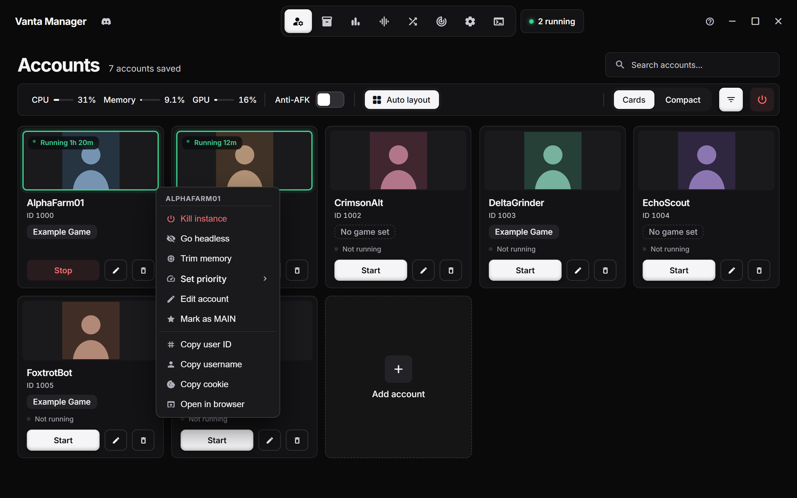
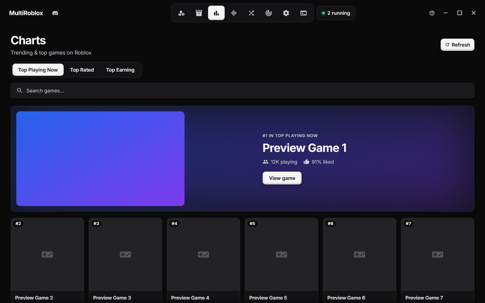
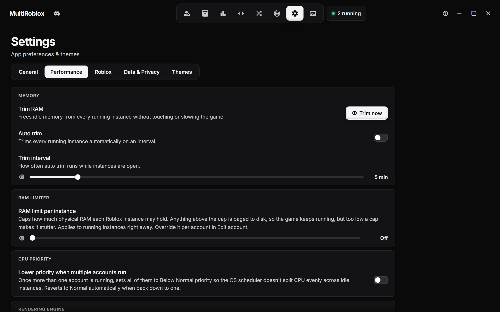
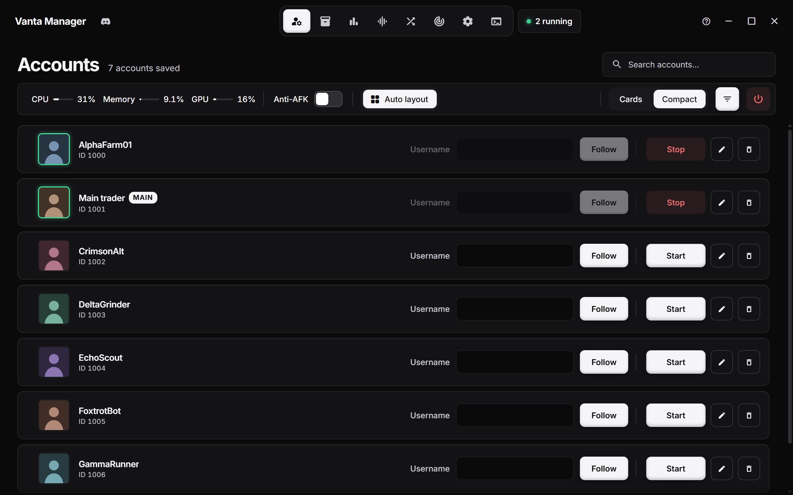
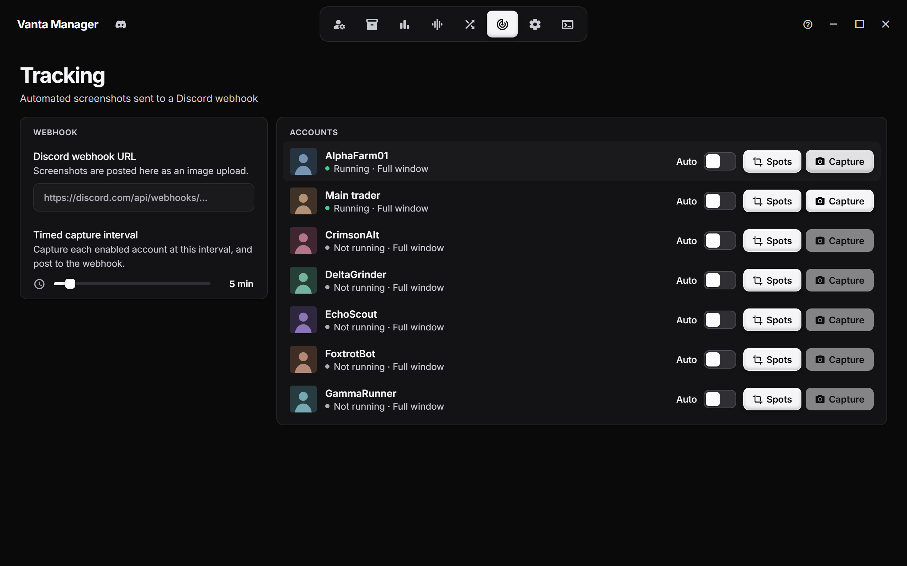

<div align="center">


# MultiRoblox

**Run as many Roblox accounts as you want, side by side, on Windows.**<br>
Launch, line up, monitor and tune every instance from one clean dashboard.

<br>

[](https://github.com/PookiePepelsss/MultiRoblox-RAM/releases)
[](https://github.com/PookiePepelsss/MultiRoblox-RAM/releases)
[](https://tauri.app/)
[](LICENSE)

<br>


</div>

<br>

## Why MultiRoblox

|   |   |
|---|---|
| **One exe, no install** | Download it, run it. The native helper is embedded, so there are no extra files to keep next to it. |
| **Real sign-in** | Log in through a real Roblox window, or paste a cookie. Cookies stay on your PC, encrypted. |
| **Every account at once** | Roblox normally allows one client. MultiRoblox opens a fresh instance for each account you start. |
| **Built for farms** | Groups, auto-relaunch, RAM limits, anti-AFK and tiled windows keep a lot of clients manageable. |

<br>

## Quick start

1. Grab `MultiRoblox.exe` from [**Releases**](https://github.com/PookiePepelsss/MultiRoblox-RAM/releases).
2. Run it, click **Add account**, and sign in.
3. Press **Start** on as many accounts as you like.

<details>
<summary><b>Build it yourself</b></summary>

<br>

You need the [Rust toolchain](https://rustup.rs) and Node.js.

```bash
git clone https://github.com/PookiePepelsss/MultiRoblox-RAM.git
cd MultiRoblox-RAM/MultiRoblox
build.bat
```

The finished exe lands in `dist\MultiRoblox.exe`.

</details>

<br>

## A look around

<table>
  <tr>
    <td width="50%"><br><sub><b>Right-click menu.</b> Kill, trim memory, set priority, edit, copy IDs.</sub></td>
    <td width="50%"><br><sub><b>Auto layout.</b> Tile every running window on your screen.</sub></td>
  </tr>
  <tr>
    <td width="50%"><br><sub><b>Mixer.</b> Render quality, FPS cap and volume for every instance.</sub></td>
    <td width="50%"><br><sub><b>Game pages.</b> Pick an account, press Play, browse servers.</sub></td>
  </tr>
  <tr>
    <td width="50%"><br><sub><b>Charts.</b> Top playing, top rated and top earning games.</sub></td>
    <td width="50%"><br><sub><b>Performance.</b> RAM limiter, RAM trim, priority and rendering engine.</sub></td>
  </tr>
  <tr>
    <td width="50%"><br><sub><b>Compact view.</b> A dense list for large account collections.</sub></td>
    <td width="50%"><br><sub><b>Tracking.</b> Timed screenshots sent to a Discord webhook.</sub></td>
  </tr>
</table>

> Screenshots use made-up sample accounts.

<br>

## Features

<details open>
<summary><b>👤 Accounts</b></summary>

<br>

- Launch as many accounts side by side as you want
- Sign in through a real Roblox login window, or paste a cookie directly
- Set a game ID, invite link, or private server link per account so it launches straight there
- Nicknames, search, filtering, and a Cards or Compact view
- Cookies encrypted with Windows DPAPI by default, or AES-256-GCM with your own passphrase, and stored locally
- Auto-relaunch when an instance closes, back into the same game (crash-loop protected)
- Right-click a running account to kill it, trim its memory, or set its process priority (Realtime down to Low)
- Live CPU, memory and GPU readout for the whole machine and for each running account

</details>

<details>
<summary><b>🪟 Auto layout</b> <sub>new</sub></summary>

<br>

- Tiles your running Roblox windows in rows on the screen, as small as 320 × 180 or as large as you like
- Choose the starting corner, the gap between windows, and which accounts to include
- Accounts you start later line up automatically after the first layout
- Undo puts every window back where it was

</details>

<details>
<summary><b>📦 Groups</b></summary>

<br>

- Bundle accounts into groups (farm squad, trading alts, etc.)
- Launch or kill an entire group at once, with a shared or per-account game target

</details>

<details>
<summary><b>🎚️ Mixer</b></summary>

<br>

- Render quality, FPS cap (10–9999) and volume for all running instances in one panel
- Graphics quality writes to Roblox's fast flags; the FPS cap writes Roblox's global client settings and can be protected so Roblox can't reset it
- Works with vanilla Roblox and any Bloxstrap-style bootstrapper (Bloxstrap, Fishstrap, Froststrap, Voidstrap and other forks). Installs are detected automatically, and you pick which one launches use in Settings › Roblox
- Live, per-instance OS-level volume control
- Kill all instances with one click

</details>

<details>
<summary><b>🎮 Charts and game pages</b></summary>

<br>

- Browse top playing now, top rated and top earning games, or search any game
- Game pages show details, screenshots, likes, and the server list (public and private)
- Press **Play** with any saved account, or join a specific server

</details>

<details>
<summary><b>📸 Tracking</b></summary>

<br>

- Automated per-account screenshots sent to a Discord webhook on a timer
- Outline one or more capture spots per account, or grab the full window

</details>

<details>
<summary><b>🕹️ Anti-AFK</b></summary>

<br>

- Taps a key into every open Roblox window on a configurable interval, so the idle kick never fires
- Pick which key is pressed in Settings

</details>

<details>
<summary><b>⚙️ Settings</b></summary>

<br>

- **General**: multi-instance status, sign-in protection between clients (error 773), anti-AFK, relaunch-on-disconnect
- **Performance**: RAM limiter (caps each instance's physical RAM, globally or per account), RAM trim (manual or automatic), block `RobloxCrashHandler.exe`, optionally lower CPU priority once several accounts are running, force a rendering engine (Direct3D 11/9, OpenGL, Vulkan) via fast flags
- **Data & Privacy**: custom encryption key or Windows DPAPI, clear all accounts
- **Themes**: light and dark, plus several accent themes
- **Sounds**: UI sound profiles with volume control and upload-your-own support

</details>

<details>
<summary><b>🎲 Generator and 📜 Logs</b></summary>

<br>

- Generate accounts with a [bloxgen.net](https://bloxgen.net/) or [altgen.me](https://altgen.me/) API key
- A live log viewer with in-page search (Ctrl+F)

</details>

<br>

## How it works

Roblox prevents multiple instances by holding a Windows mutex. MultiRoblox grabs that mutex first through a small native helper (`RobloxNative.exe`, written in C#), so Roblox opens a fresh instance every time. Each account gets its own auth ticket before launch, so every window signs in as a different account.

Login opens a native, chromeless window with no external browser involved, and reads the session cookie once you sign in. The helper is embedded in the app, so the exe runs on its own.

<br>

## FAQ

<details>
<summary><b>Will Roblox ban me for this?</b></summary>

<br>

Running multiple accounts isn't something Roblox actively bans for normal use, but using this software is at your own risk. See the disclaimer below.

</details>

<details>
<summary><b>My antivirus flags RobloxNative.exe</b></summary>

<br>

Running two Roblox clients at once means closing Roblox's single-instance lock, which looks like a cheat tool to heuristic scanners. It's a false positive. The helper is one readable C# file in this repo, but the app isn't code-signed, so nothing vouches for it automatically.

</details>

<details>
<summary><b>Where are my cookies stored?</b></summary>

<br>

Locally on your PC, encrypted with Windows DPAPI by default, or with AES-256-GCM if you set your own key. Nothing is uploaded anywhere.

</details>

<br>

## Disclaimer

Using this software is at your own risk. The author is not responsible for any bans, suspensions, or other action taken against your account. MultiRoblox is not affiliated with Roblox Corporation.


## Support

If MultiRoblox saved you time, consider tossing a tip my way.

| Coin | Address |
|---|---|
| BTC | `15kEbCxtNKbQ2g16AmiW8BeEKU3h6i9S46` |
| ETH | `0x179ab005a9CD84769934aB66825D38C347D9AB4d` |
| LTC | `LTLYLK9mUMVUk9Gk5j3W8oYqtq1cYiU3Uy` |

<br>

## License

Free to use, modify and share for non-commercial use. You may not sell it, and any copy or fork must credit **PookiePepelsss** as the original author. See [LICENSE](LICENSE) for the full text.

<div align="center">
<br>
<sub>Made by PookiePepelsss</sub>
</div>
